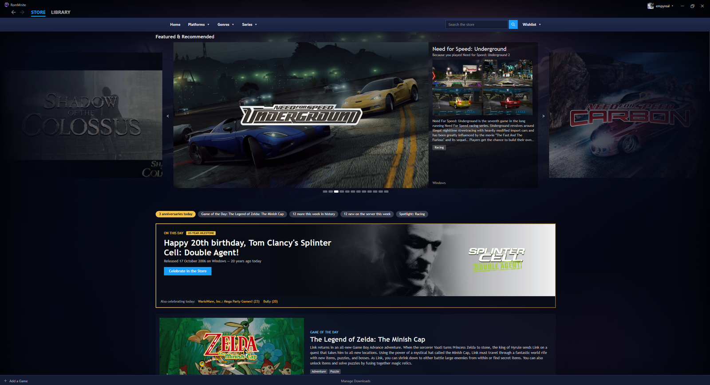
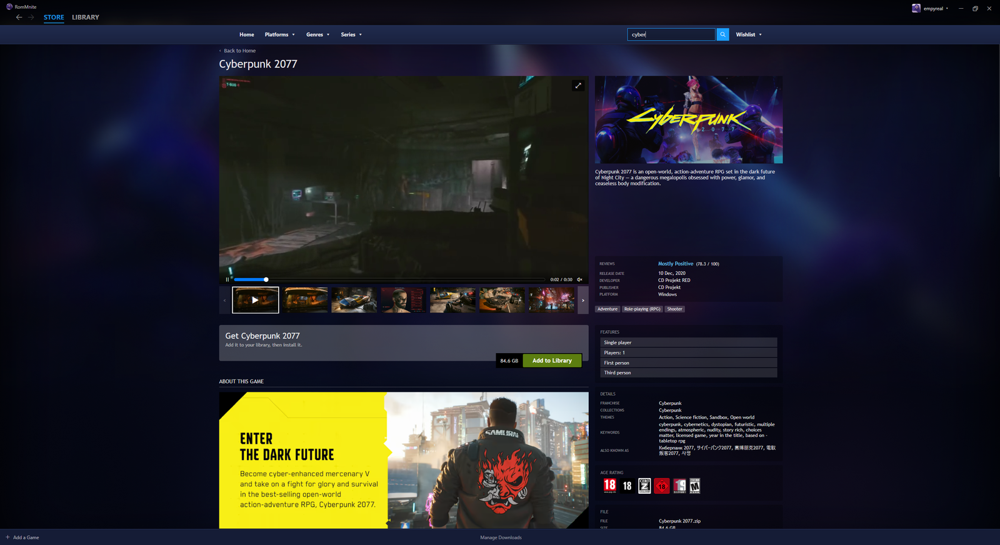
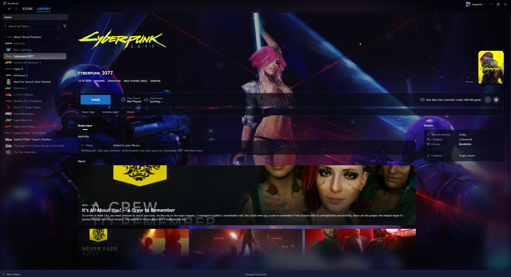

<!-- trunk-ignore-all(markdownlint/MD033) -->
<!-- trunk-ignore(markdownlint/MD041) -->
<div align="center">

  
  <h3 style="font-size: 25px;">RomMnite: a Steam-like Playnite for your RomM server.</h3>
  <p>Created by Empyreai. Based on the <a href="https://github.com/rommapp/playnite-plugin">RomM Library Importer</a> by The RomM Team.</p>

[![license-badge-img]][license-badge]
[![release-badge-img]][release-badge]

</div>

# Overview

RomMnite turns [Playnite](https://playnite.link) into a Steam-like home for your [RomM](https://github.com/rommapp/romm) server. One extension, with its own theme included:

- **Library**: your RomM games in Playnite, installed from the server on demand, with a Home page, shelves, a Downloads page and games on several platforms shown once, with a button to switch between versions.
- **Store**: browse the whole server like a storefront: Home with featured games, Platforms, Genres and Series pages, search, and game pages with screenshots, videos, reviews, compatibility notes and the other versions of each game. It loads in the background, after the library and behind anything you're doing.
- **Emulators set up for you**: downloaded and configured on first use, fullscreen, with your controller, rendering at your display's resolution where the emulator allows it, and closing with the game.
- **Cloud saves**: synced with RomM before and after each session, while playing, and for every installed game at start-up. Windows games' saves go through [Ludusavi](https://github.com/mtkennerly/ludusavi), downloaded when needed. Progress made offline is kept and uploaded once RomM is back; when both sides changed, the save that loses is kept as a backup.
- **Achievements**: RetroAchievements through RomM, plus PS3 trophies (RPCS3) and Xbox 360 achievements (Xenia) kept per account, with unlock pop-ups during play.
- **In-game overlay**: the Home button opens play time, achievements and Resume / Quit over emulated games, and over Windows games running borderless or windowed.
- **Accounts**: several RomM accounts on one PC, each with its own library, saves and achievements.

# Screenshots

The Store's Home: featured games, today's anniversaries and the game of the day.



A game's page: with its trailer, screenshots, reviews and details.



The library: the same game once added, with its cloud save status and news.



# Requirements

- Windows with Playnite 10 (Playnite SDK 6.18 or newer).
- A RomM server, version 4.9 or newer, set up with metadata providers (IGDB at least). See [RomM's docs](https://docs.romm.app/latest/Getting-Started/Generate-API-Keys/).
- Cloud saves need a RomM version with its device sync API.

# Installation

1. Download the `.pext` file from the [latest release](https://github.com/Empyreai/RomMnite/releases/latest).
2. Open it (or drag it onto Playnite) and restart Playnite when asked.
3. Sign in to your RomM server when RomMnite asks; the RomMnite theme is selected on first start.

Coming from the RomM Library Importer or an earlier RomMnite build named `RomM_9700aa21-...`: uninstall that add-on first (Add-ons > Extensions). Your settings and data are kept.

# Building

```
msbuild RomM.csproj /restore /p:Configuration=Release /p:Platform="AnyCPU" /p:CopyLocalLockFileAssemblies=true
Toolbox.exe pack bin\Release\net462 <output folder>
```

# Support

None. RomMnite is a personal project, released as-is and maintained as-is: there is no issue tracker, and bug reports and feature requests aren't taken. You're welcome to fork it and change it yourself under the license below. Problems with RomM itself belong in the [RomM repository](https://github.com/rommapp/romm/issues/new/choose).

# License and acknowledgements

RomMnite is free software under the GNU General Public License v3.0 ([LICENSE](./LICENSE)), like the RomM Library Importer it is based on. Thanks to The RomM Team for the importer and for RomM, and to [@psychonic](https://github.com/psychonic)'s [Playnite EmuLibrary](https://github.com/psychonic/Playnite-EmuLibrary), which inspired the original importer.

[license-badge-img]: https://img.shields.io/github/license/Empyreai/RomMnite?style=for-the-badge&color=a32d2a
[license-badge]: LICENSE
[release-badge-img]: https://img.shields.io/github/v/release/Empyreai/RomMnite?style=for-the-badge
[release-badge]: https://github.com/Empyreai/RomMnite/releases
